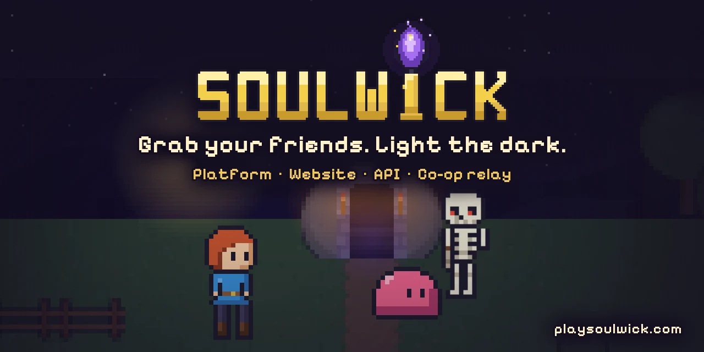

<div align="center">

<a href="https://playsoulwick.com"></a>

# Soulwick Platform

**Grab your friends. Light the dark.**

Everything online behind [Soulwick](https://github.com/WebBude-de/soulwick), the pixel roguelite you
jump into with your friends: website, player API, co-op relay and admin panel.

[](LICENSE)
[](LICENSE-ASSETS.md)
[](https://bun.sh)
[](https://nextjs.org)
[](https://hono.dev)
[](https://www.prisma.io)
[](https://www.typescriptlang.org)
[](https://playsoulwick.com)

**[Website](https://playsoulwick.com)** ·
**[Play in your browser](https://game.playsoulwick.com)** (from release) ·
[Leaderboards](https://playsoulwick.com/leaderboards) (from release) ·
[Game repo](https://github.com/WebBude-de/soulwick) ·
[Downloads](https://github.com/WebBude-de/soulwick/releases) ·
[Docs (German)](docs/)

</div>

> 🇩🇪 Die Projektdokumentation ist auf Deutsch: [docs/](docs/) und im Spiel-Repo
> [docs/README.md](https://github.com/WebBude-de/soulwick/blob/main/docs/README.md). Issues and pull
> requests are welcome in English or German.

## What is this?

The game itself lives in [WebBude-de/soulwick](https://github.com/WebBude-de/soulwick) and stays
playable without any server. This repository holds everything that needs one:

- **Website** – [playsoulwick.com](https://playsoulwick.com) (English and German): landing page, news,
  account deletion and legal pages; leaderboards and guild pages once the live features are switched
  on (`LIVE_FEATURES`).
- **Player API** – sign-in without e-mail or password (guest per device, Steam, Google Play), linked
  accounts, guilds, run reports, leaderboards, bug reports from the game.
- **Co-op relay** – rooms with a room code; forwards game packets without reading them.
- **Admin panel** – moderation of players, guilds and runs, live rooms, audit log.

## Stack

Bun workspaces with Turborepo, Next.js and Tailwind for the two web apps, Hono on Bun for the API,
a Bun WebSocket server for the relay, PostgreSQL via Prisma, zod contracts shared by every app (and
mirrored by the game's GDScript client), Biome with the Ultracite presets, Husky hooks. Details:
[docs/TECHSTACK.md](docs/TECHSTACK.md).

| Folder | Package | What | Local port |
| --- | --- | --- | --- |
| `apps/web` | `@soulwick/web` | website (Next.js, EN/DE) | 3100 |
| `apps/admin` | `@soulwick/admin` | admin panel (Next.js) | 3102 |
| `apps/api` | `@soulwick/api` | player and admin API (Hono on Bun) | 3101 |
| `apps/relay` | `@soulwick/relay` | WebSocket relay for co-op (Bun) | 3103 |
| `packages/contracts` | `@soulwick/contracts` | API and relay contracts (zod), the single source of truth | – |
| `packages/db` | `@soulwick/db` | Prisma schema, migrations, client | – |
| `packages/config` | `@soulwick/config` | shared TypeScript config | – |
| `infra/` | – | local services only (`docker-compose.yml`: Postgres) and the server guide | 5532 |

## Quick start

You need [Bun](https://bun.sh) 1.3, Node 24 (Next.js runs on it) and Docker.

```bash
bun install                      # dependencies and Husky hooks
cp .env.example .env.local       # then fill in BETTER_AUTH_SECRET, RELAY_INTERNAL_KEY, DEV_AUTH_KEY
for app in api relay web admin; do cp apps/$app/.env.example apps/$app/.env.local; done
cp infra/.env.example infra/.env.local
bun run services:up              # local Postgres (container soulwick-postgres, port 5532)
bun run db:deploy                # apply migrations
bun run db:seed:dev              # test data: admins, players, a guild, runs
bun dev                          # web 3100, admin 3102, API 3101, relay 3103
```

Generate secrets with e.g. `openssl rand -base64 48`. Only the `.env.example` files are committed;
every other `.env*` file is ignored by git. Stop the database with `bun run services:down` (data stays
in the Docker volume).

**Local logins after the seed** (local test data only): admin `admin@soulwick.local`, moderator
`moderator@soulwick.local`, password `soulwick-admin-local`. A test player signs in with
`POST /auth/device` and `{ "deviceId": "<UUID>", "name": "Lumen" }`. The game started from the Godot
editor talks to `localhost:3101` (API) and `localhost:3103` (relay) automatically; the local browser
version of the game runs on `localhost:3110`. The local ports follow the desktop's port block scheme
(block 1, P-035); the Docker images keep their container ports (API 8787, relay 8790, web 3000,
admin 3001).

## Checks

| What | Command |
| --- | --- |
| Lint and format (Biome) | `bun run check` (fix: `bun run fix`) |
| Types | `bun run typecheck` |
| Tests (API and relay, against a throwaway database) | `bun run test` (needs `bun run services:up`) |
| Build | `bun run build` |
| Migrations match the schema | `bun run db:verify` |

New migration: change `packages/db/prisma/schema.prisma`, then `bun run db:migrate --name <name>`.

## Deployment

Each app runs on [Dokploy](https://dokploy.com) from its own Dockerfile, with one Postgres database per
environment: `development` on `dev.playsoulwick.com` (plus `api-dev.`, `admin-dev.`, `play-dev.`) and
`production` without a prefix. Step by step (German): [infra/DOKPLOY.md](infra/DOKPLOY.md).

## Docs (German)

| File | What |
| --- | --- |
| [soulwick/docs/PRODUKT.md](https://github.com/WebBude-de/soulwick/blob/main/docs/PRODUKT.md) | product overview for **both** repositories |
| [docs/PRD.md](docs/PRD.md) | what the platform has to do, for whom, and what not |
| [docs/ARCHITECTURE.md](docs/ARCHITECTURE.md) | structure, data model, flows |
| [docs/TECHSTACK.md](docs/TECHSTACK.md) | tools, guidelines, all commands and variables |
| [docs/KONZEPT_ONLINE.md](docs/KONZEPT_ONLINE.md) | relay protocol, sign-in via the stores, versions |
| [docs/ROADMAP.md](docs/ROADMAP.md) | packages and status |
| [docs/DECISIONS.md](docs/DECISIONS.md) | technical decisions (P numbers); product decisions (D numbers) live in the [game repo](https://github.com/WebBude-de/soulwick/blob/main/docs/DECISIONS.md) |
| [docs/design/README.md](docs/design/README.md) | design tokens, concepts, art briefings and mockups per app |
| [AGENTS.md](AGENTS.md) | working with AI agents |

## Contributing

Bug reports, ideas and pull requests are welcome – read [CONTRIBUTING.md](CONTRIBUTING.md) first.
Bugs in the game itself belong in the [game repo](https://github.com/WebBude-de/soulwick/issues). We
follow the [Code of Conduct](CODE_OF_CONDUCT.md). Security issues go through
[SECURITY.md](SECURITY.md), not public issues.

## License

- **Code:** GPL-3.0-or-later, see [LICENSE](LICENSE).
- **Content:** artwork, music and sound in `apps/*/public/`, the logo, the name "Soulwick" and the
  characters (Wick, the chicken) are © WebBude, all rights reserved – see
  [LICENSE-ASSETS.md](LICENSE-ASSETS.md).
- Third-party parts (npm packages, fonts): [THIRD_PARTY.md](THIRD_PARTY.md).

<div align="center">

Made with ♥ by [WebBude](https://web-bude.de)

</div>
